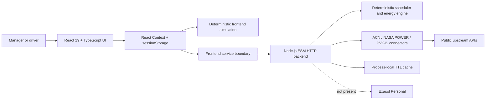

# EVOS — Electric Vehicles Operations & Sustainability

> **Make every charging decision explainable before the fleet leaves.**

EVOS is a role-based prototype for EV depot operations. It brings vehicle readiness, charger allocation, energy dispatch, battery-health estimates, sustainability trade-offs, alerts, scenarios, and decision rationale into one workspace for fleet operators and drivers.

> **Submission note:** The current repository does not contain Exasol Personal integration, Exasol SQL, or database-backed analytical queries. This is documented as a blocker rather than claimed as complete.

## Contents

- [Problem](#problem)
- [Solution](#solution)
- [Implemented features](#implemented-features)
- [Architecture](#architecture)
- [Exasol Personal status](#exasol-personal-status)
- [Technology stack](#technology-stack)
- [Data and provenance](#data-and-provenance)
- [Quick start](#quick-start)
- [Usage](#usage)
- [Testing](#testing)
- [Deployment](#deployment)
- [ExaThon deliverables](#exathon-deliverables)
- [Limitations](#limitations)
- [License](#license)

## Problem

Fleet operators cannot coordinate vehicle readiness, charger capacity, and site-energy trade-offs in one explainable workflow because the relevant signals are distributed across separate views and often incomplete. If this were solved, operators could compare charging decisions before departure and understand the constraints behind each recommendation.

This is a mobility and energy operations problem: a charger may be incompatible, a vehicle may miss its departure target, or a plan may conflict with grid, storage, tariff, carbon, or battery-health assumptions. EVOS makes those trade-offs visible without presenting a prototype simulation as physical telemetry.

## Solution

EVOS connects the workflow from planning to explanation:

1. Inspect readiness, active sessions, alerts, and energy context.
2. Review or edit the browser-local vehicle registry and operating assumptions.
3. Compare FCFS, rule-based, and EVOS weighted scheduling strategies.
4. Inspect charger assignments, rationale, alternatives, constraints, and departure risk.
5. Review PV, storage, grid, tariff, carbon, cost, emissions, and renewable-share outputs.
6. Run fault scenarios, what-if comparisons, and experiments.
7. Switch to the driver view for one vehicle's SoC, projected completion, and compatible plugs.

## Implemented features

- Manager workspace covering overview, fleet, scheduler, energy, system view, battery, forecasts, sustainability, explainability, maintenance, scenarios, experiments, alerts, datasets, settings, and methodology.
- Driver workspace showing vehicle readiness, target SoC, projected completion, session timing, tariff context, and compatible chargers.
- Deterministic 15-minute scheduling over a 24-hour operating day.
- FCFS, rule-based, and EVOS weighted scheduling strategies.
- Charger compatibility, power limits, charger uniqueness, faults, delays, and departure-risk flags.
- Solar → storage → grid dispatch with reserve and grid-limit calculations.
- Explainable score components, rationale, alternatives, constraints, and provenance badges.
- Deterministic battery SoH estimates with uncertainty and maintenance indicators.
- Sustainability outputs including cost, emissions, renewable share, peak import, and baseline comparison.
- Browser-local vehicle editing and local CSV/JSON import validation.
- Server connectors for ACN-Data, NASA POWER, and PVGIS when configured.

## Screenshots

No genuine screenshots were present in the repository audit. Do not use fabricated images. Capture screenshots from a clean local run and place them in `docs/submission/assets/` before final submission. Track them in [`docs/submission/ASSETS.md`](docs/submission/ASSETS.md).

## Architecture



The active runtime is the React/Vite frontend and stateless Node backend. The Supabase/Hono files are generated scaffolding and are not the active persistence layer. See [`docs/ARCHITECTURE.md`](docs/ARCHITECTURE.md).

## Exasol Personal status

**BLOCKED — no Exasol integration was found in the current repository.**

Repository inspection found no Exasol driver, connection configuration, SQL schema, SQL query, load script, backend endpoint, or UI screen consuming Exasol results. The current backend reports persistence as not configured and uses in-memory/demo data plus external source connectors.

This means EVOS cannot truthfully claim current Exasol usage. To satisfy the ExaThon requirement, the project still needs a verified Exasol Personal workflow using public or synthetic data, reproducible schema/load instructions, real analytical SQL, a backend/API result path, tests, and visible evidence in the demo and deck.

## Technology stack

- React 19, React DOM 19, TypeScript 5.7
- Vite 8
- Tailwind CSS 4 via `@tailwindcss/vite`
- Node.js ESM with the built-in `http` module
- `lucide-react`
- Custom SVG charts and energy schematic
- React Context and browser `sessionStorage`
- pnpm and Node's built-in test runner

## Data and provenance

ACN-Data is historical charging-session data, not physical real-time telemetry, and is not mapped to EVOS vehicle identities. NASA POWER supplies solar/weather point data when usable. PVGIS supplies modelled/historical PV data, not inverter telemetry. Fleet, charger, SoC, schedule, tariff fallback, carbon fallback, and fault values are simulated or calculated unless explicitly configured.

The repository is intended to use public or synthetic data only. Verify attribution and source terms before submission. Never place ACN credentials in `VITE_*` variables or commit `.env` files. See [`docs/DATA_SOURCES.md`](docs/DATA_SOURCES.md).

## Quick start

### Prerequisites

- Node.js 22+
- pnpm
- Git

### Install

```bash
git clone https://github.com/sarfarajmulla-data/DesignEVOS.git
cd DesignEVOS
pnpm install
```

### Configure

Create `.env.local` from `.env.example`:

```dotenv
VITE_BACKEND_URL=http://localhost:8787
VITE_SITE_LATITUDE=28.6139
VITE_SITE_LONGITUDE=77.209
```

Create `backend/.env` from `backend/.env.example`:

```dotenv
ACN_DATA_API_KEY=replace_me_locally
PORT=8787
CORS_ORIGINS=http://localhost:8443,http://127.0.0.1:8443
```

The complete environment reference is in [`docs/SETUP.md`](docs/SETUP.md). There is currently no Exasol setup command because no Exasol integration exists in this branch.

### Run

Terminal 1:

```bash
node --env-file=backend/.env backend/server.mjs
```

Terminal 2:

```bash
pnpm run dev -- --host 0.0.0.0 --port 8443
```

Open `http://localhost:8443/`. On Windows, `run-local.bat` starts both services.

## Usage

- Public site: `/#/`
- Manager overview: `/#/app/overview`
- Fleet: `/#/app/fleet`
- Scheduler: `/#/app/scheduler`
- Energy: `/#/app/energy`
- Explainability: `/#/app/explain`
- Scenarios: `/#/app/scenarios`
- Experiments: `/#/app/experiments`
- Datasets: `/#/app/datasets`
- Driver view: `/#/app/driver`

Use Settings to edit assumptions, Fleet to manage browser-local vehicles, Maintenance to inject documented faults, and Datasets to inspect source status and limitations.

## Testing

```bash
node --test backend/tests/*.test.mjs
pnpm exec tsc --noEmit -p .
pnpm run build
```

These commands cover the documented Node tests, TypeScript validation, and Vite production build. No Exasol/database tests exist because Exasol is not currently integrated.

## Deployment

The repository includes Vercel routing for the Vite frontend and serverless-compatible Node backend. Deployment requires a Vercel project, correct environment variables, CORS configuration, and independent verification of `/api/v1/health`. See [`docs/DEPLOYMENT.md`](docs/DEPLOYMENT.md).

Do not treat a URL in historical documentation as proof of current deployment availability.

## ExaThon deliverables

| Requirement | Artifact | Status |
|---|---|---|
| Problem statement | [`docs/PROBLEM_STATEMENT.md`](docs/PROBLEM_STATEMENT.md) | Present |
| Public repository | This repository | Present |
| Pitch deck PDF/PPT | [`docs/submission/PITCH_DECK_OUTLINE.md`](docs/submission/PITCH_DECK_OUTLINE.md) | Binary deck pending |
| Demo video ≤ 3 minutes | [`docs/submission/DEMO_SCRIPT.md`](docs/submission/DEMO_SCRIPT.md) | Script present; video pending |
| README | This file | Present |
| Setup and run guide | [`docs/SETUP.md`](docs/SETUP.md), [`docs/RUN_GUIDE.md`](docs/RUN_GUIDE.md) | Present |
| Deployment instructions | [`docs/DEPLOYMENT.md`](docs/DEPLOYMENT.md) | Present |
| MIT/Apache-2.0 license | [`LICENSE`](LICENSE) | Present |
| Exasol Personal data platform | [`docs/submission/EXATHON_CHECKLIST.md`](docs/submission/EXATHON_CHECKLIST.md) | Blocked |

## Limitations

The prototype has no physical telemetry, OCPP/MQTT control, persistent fleet database, authentication, authorization, multi-tenant isolation, persistent audit log, or verified Exasol integration. Fleet edits are browser-session state. Forecasts and battery-health outputs are deterministic estimates, not production ML or battery diagnoses. See [`docs/LIMITATIONS.md`](docs/LIMITATIONS.md).

## License

EVOS is released under the [MIT License](LICENSE).

## Contributing

Keep changes focused, preserve provenance labels, never commit secrets, and distinguish verified functionality from future work in documentation.
