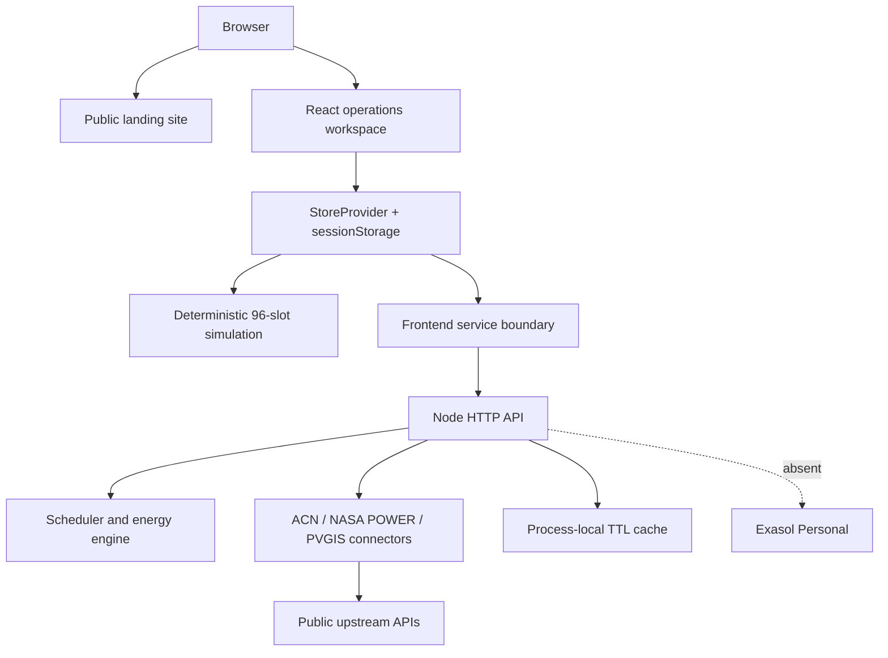

# Architecture

EVOS currently runs as a React/Vite frontend plus a stateless Node.js ESM backend.

## Evidence in the codebase

- `src/main.tsx` mounts the React app.
- `src/App.tsx` chooses the public site or lazy-loaded app routes.
- `src/lib/store.tsx` owns assumptions, browser-session state, alerts, faults, and live parameters.
- `src/lib/sim.ts` calculates vehicle states, sessions, energy flows, totals, and alerts.
- `src/services/index.ts` defines the service boundary and calls `/api/v1/live/parameters`.
- `backend/server.mjs` exposes the stateless API.
- `backend/connectors/sources.mjs` contains external source adapters.
- `vercel.json` describes the frontend/backend deployment routing.

## Exasol status

No Exasol driver, SQL, schema, connection environment variables, loader, query route, or UI result was found. Exasol is therefore not part of the current runtime. A future implementation must load public/synthetic normalized operational data into Exasol Personal, execute versioned SQL, expose verified results through the backend, and show those results in the application or a documented API response.
