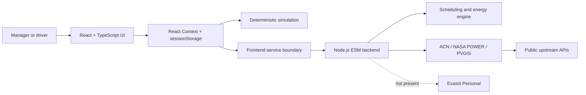

# EVOS

## Electric Vehicles Operations & Sustainability

**Make every charging decision explainable before the fleet leaves.**

A role-based prototype for EV depot readiness, charger scheduling, energy dispatch, sustainability analysis, and decision rationale.

> ExaThon submission asset: this is a source deck in Markdown. A final PDF/PPT export and verified Exasol evidence are still required.

---

# The problem

Fleet operators cannot coordinate:

- vehicle readiness before departure;
- charger compatibility and limited capacity;
- grid, solar, storage, tariff, and carbon trade-offs;
- battery-health signals and maintenance risk;
- the reason behind each scheduling decision.

The signals are often separated across views and incomplete.

**Result:** operators can struggle to compare feasible charging decisions before vehicles leave.

---

# Who is affected?

## Primary user

**EV fleet or depot operator** preparing multiple vehicles for service.

## Secondary user

**Driver** who needs to know:

- current and target state of charge;
- projected completion time;
- departure readiness;
- which compatible charger is available.

## Product response

EVOS connects those decisions in one inspectable workspace without claiming that simulated values are physical telemetry.

---

# The EVOS workflow

1. Inspect fleet readiness, sessions, alerts, and energy context.
2. Review or edit the browser-local vehicle registry.
3. Compare FCFS, rule-based, and EVOS weighted scheduling.
4. Inspect assignment rationale, constraints, alternatives, and risk.
5. Review solar, storage, grid, cost, emissions, and renewable share.
6. Test faults, scenarios, and strategy experiments.
7. Switch to Driver view for vehicle-specific readiness and compatible plugs.

**One model. Multiple operational perspectives.**

---

# What is implemented

- React 19 + TypeScript operations workspace.
- Hash-routed Manager and Driver views.
- 96 fifteen-minute slots across a deterministic operating day.
- Three scheduling strategies.
- Connector and power compatibility checks.
- Grid-limit-aware energy dispatch with storage reserve.
- Explainable score components and scheduling rationale.
- Battery SoH estimates with uncertainty.
- Sustainability, alerts, maintenance, scenarios, and experiments.
- ACN-Data, NASA POWER, and PVGIS server connectors when configured.
- Explicit provenance labels for simulated, calculated, modelled, historical, and unavailable values.

---

# Product walkthrough

## Screens to capture before export

> **Screenshot placeholder — replace with genuine capture**

- Manager Overview: readiness, sessions, alerts, and energy mix.
- Scheduler: strategy comparison and decision rationale.
- Energy: PV, storage, grid, and charger flow.
- Driver: SoC, projected completion, and compatible plugs.
- Datasets: source status and provenance limitations.

No screenshots are currently present in the repository. See `docs/submission/ASSETS.md`.

---

# Architecture

The active runtime is the React/Vite frontend plus the stateless Node backend. The generated Supabase/Hono scaffold is not the active persistence layer.

---

# Exasol Personal

## Current status: BLOCKED

Repository inspection found no:

- Exasol driver or client;
- connection configuration;
- schema or load script;
- SQL analytical query;
- backend query endpoint;
- UI screen consuming Exasol results.

Therefore this deck does **not** claim Exasol usage, query results, performance, or impact.

## Required before final submission

1. Load public or synthetic EV operational data into Exasol Personal.
2. Add reproducible schema and load instructions.
3. Run versioned analytical SQL.
4. Expose verified results through the backend/API.
5. Show the result in the application or a documented response.
6. Add tests and evidence to the demo and final deck.

---

# Analytical value today

The current verified value is a deterministic, explainable prototype model that connects:

- readiness and departure risk;
- charger allocation;
- site energy dispatch;
- cost and carbon assumptions;
- battery-health estimates;
- scenarios and strategy comparisons.

All fleet, charger, telemetry, forecast, and energy operations remain simulated or calculated unless source metadata says otherwise.

> Do not add unsupported statistics, customer claims, benchmarks, or environmental impact claims.

---

# Boundaries and next steps

## Current boundaries

- No physical telemetry or charger actuation.
- No OCPP, MQTT, smart-meter, or inverter integration.
- No authentication, authorization, tenancy, or persistent fleet database.
- Fleet edits are browser-session state.
- Forecasts and battery-health outputs are deterministic estimates.
- No Exasol Personal integration yet.

## Next steps

- Verified Exasol Personal analytical platform.
- Persistent operational and audit records.
- Authenticated multi-user workflows.
- Validated telemetry ingestion.
- Genuine screenshots, final PDF/PPT, and three-minute demo video.

---

# Close

## EVOS connects the decisions that determine whether an EV fleet is:

- ready;
- feasible;
- energy-aware;
- sustainability-aware;
- explainable.

**Repository:** `sarfarajmulla-data/DesignEVOS`

**Setup:** `docs/SETUP.md`  
**Run guide:** `docs/RUN_GUIDE.md`  
**Problem statement:** `docs/PROBLEM_STATEMENT.md`  
**Submission checklist:** `docs/submission/EXATHON_CHECKLIST.md`

> Final submission remains blocked until Exasol Personal integration, genuine screenshots, a binary deck export, and a recorded demo are verified.
